#  Ashen Vigil

[](https://github.com/notenoughsp/ashen-vigil/actions/workflows/ci.yml)

A dark-fantasy survivors-like in Rust ([macroquad](https://macroquad.rs)). Hold out against the endless dark until dawn (30:00), alone or with up to three friends online.

**[Download the latest AshenVigil.exe](https://github.com/notenoughsp/ashen-vigil/releases/latest)**: one file for 64-bit Windows, nothing to install.

| | |
|---|---|
| 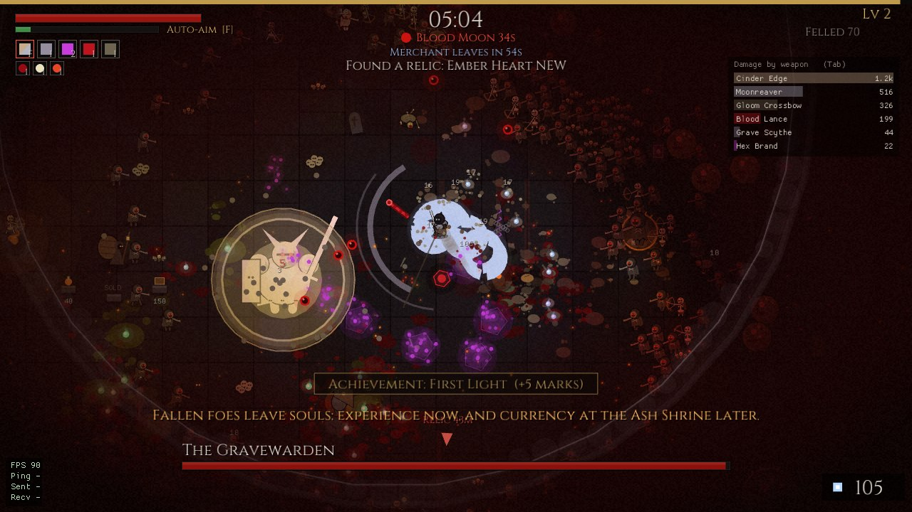 | 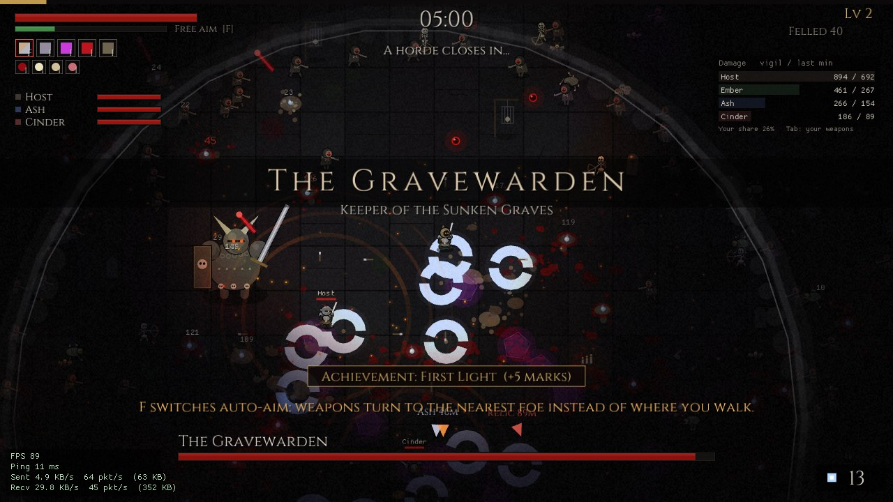 |
| 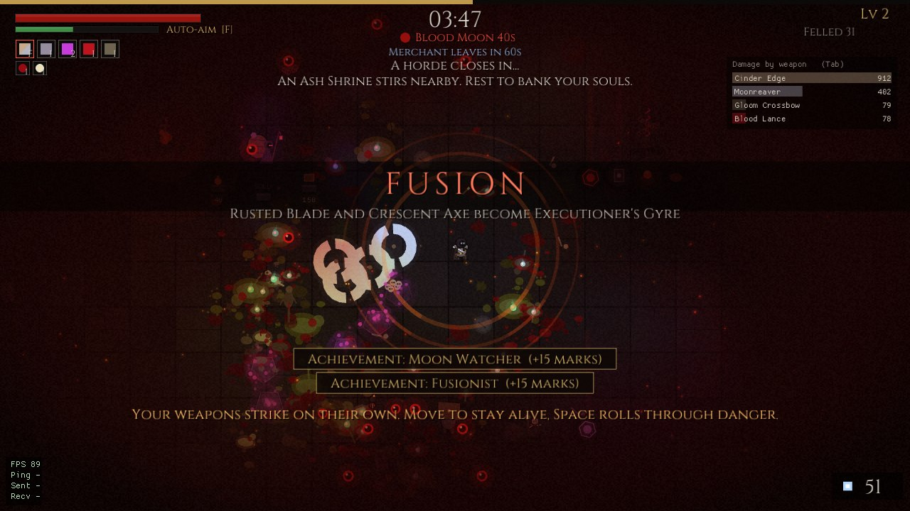 | 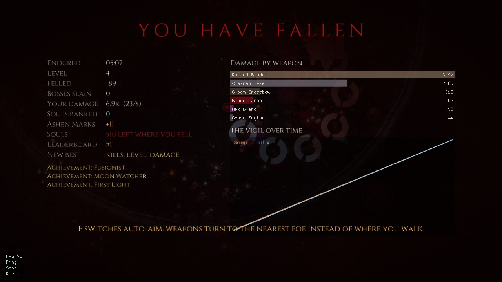 |

## Gallery

**Foes and lords.** Thirteen kinds of foe across the top, the ten lords below them, the classes in the middle.

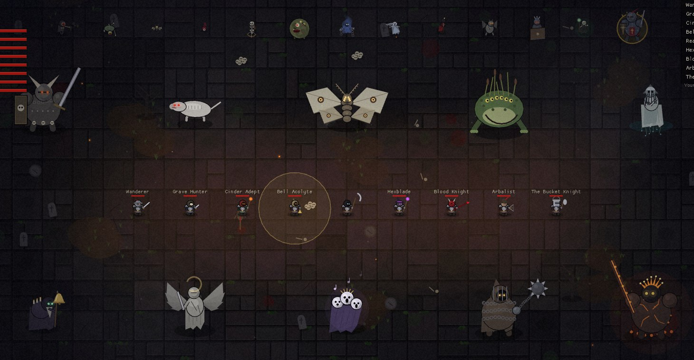

**Three fields.** The Graveyard; the Hallowed Cathedral, bright marble under coloured light from its windows; and the Flesh Pits, living ground and blood everywhere. Braziers burn where someone lit them; the lords announce themselves.

| | |
|---|---|
|  | 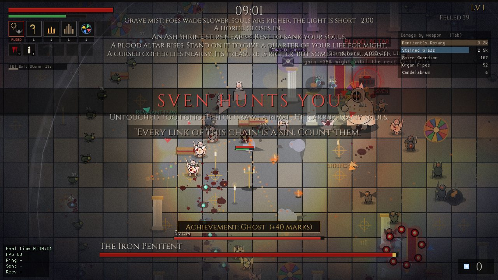 |
| 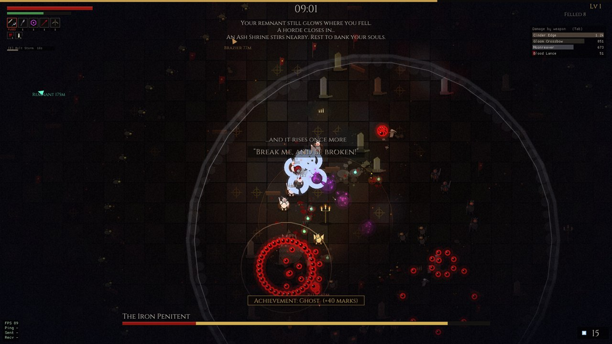 | 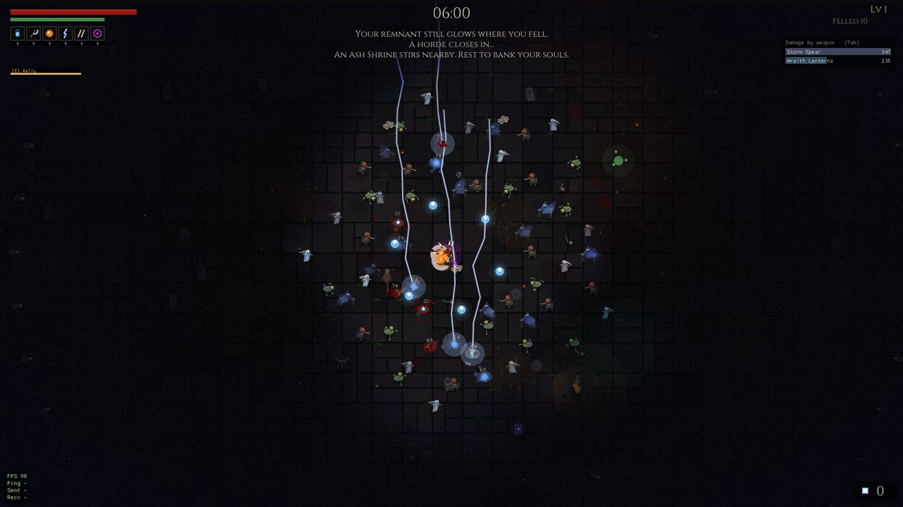 |

**Skins and the Wardrobe.** Twenty-eight looks for every class, ten of them earned by giving souls and marks away.

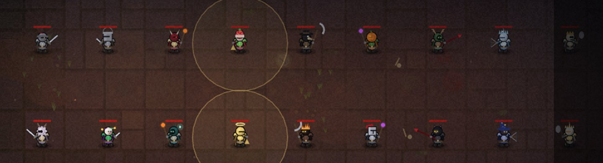

| | |
|---|---|
| 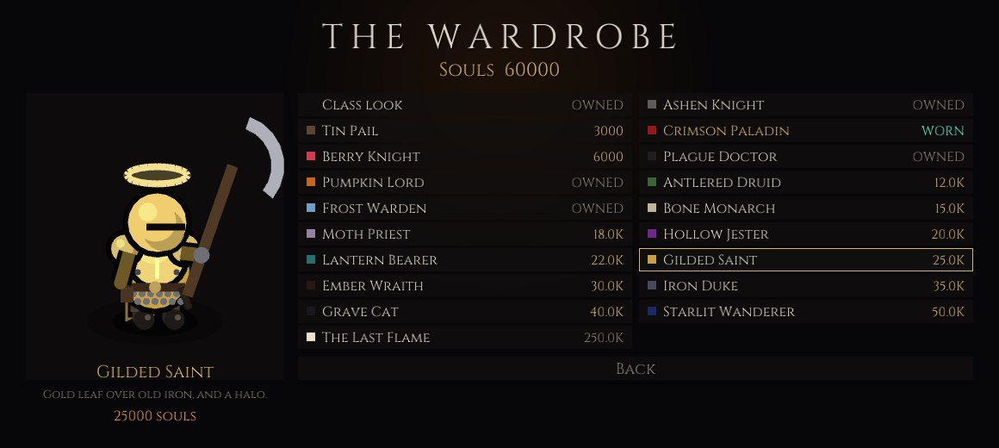 | 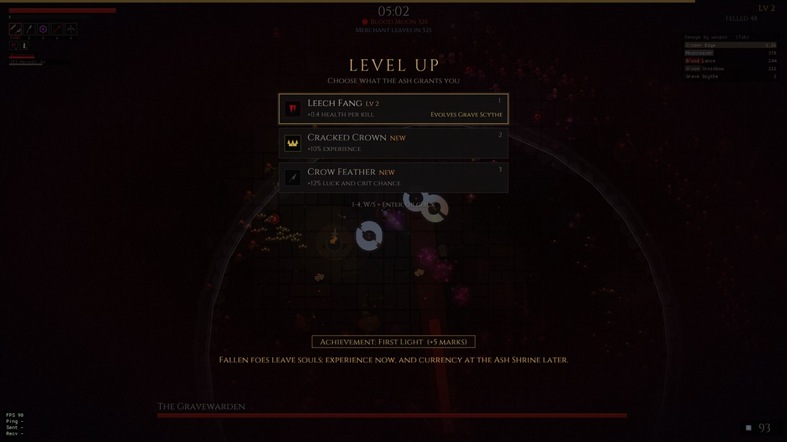 |
| 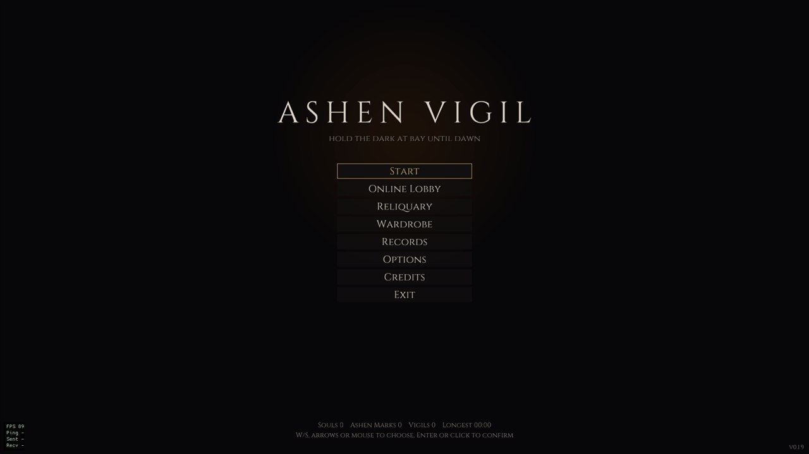 | 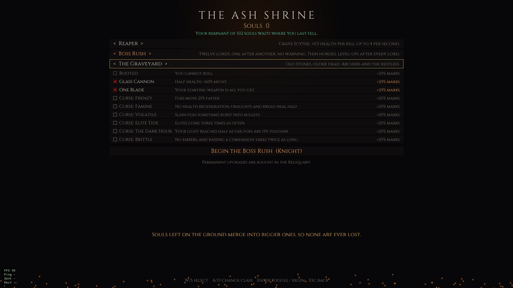 |
| 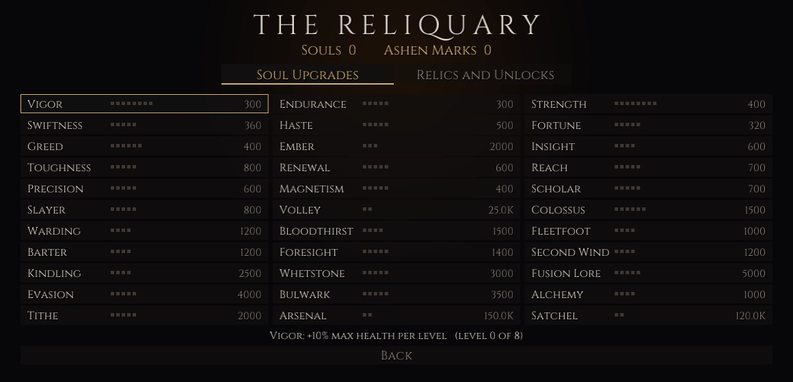 | |

## Build from source

With [Rust](https://rustup.rs) installed: `cargo run --release`. On Windows the scripts below do the rest. Releases are built by CI: pushing a tag like `v0.1.2` publishes a new release (small fixes raise the last number by one) with the exe.

```powershell
.\scripts\run.ps1          # build release and play
.\scripts\package.ps1      # dist/AshenVigil.exe: one file, everything embedded
.\scripts\autotest.ps1     # game plays itself ~10 s and writes screenshots to shots/
.\scripts\nettest.ps1      # host and client on localhost play together and write screenshots
```

## Online co-op (2-4 players)

Main menu > Online Lobby. One player chooses **Host a vigil** (UDP port 7777), the others join:

- **Tailscale**: everyone in the same tailnet. The lobby lists online Tailscale devices; pick the host's device, or type its `100.x.y.z` address or MagicDNS name. No port forwarding needed.
- **Direct IP**: type the host's IP (`1.2.3.4` or `1.2.3.4:7777`). Over the internet the host must forward UDP 7777 on their router. Windows asks once whether the game may use the network; allow it.

The host simulates the world and sends each player a snapshot 30 times a second, cut to what that player's screen shows and coded against the last snapshot the player confirmed, so only changes travel: about 15-20 KB/s per joined player, so a host with three companions needs roughly 45-60 KB/s of upload. During level-up pauses the rate drops to 10 snapshots a second. Players send their input 60 times a second. All players need the same version of the game. The host's difficulty applies. Level-ups pause the game for everyone until all players have chosen, then a 2.5 s countdown resumes it. A fallen player can be revived by standing next to them for 3 s; shrines and boss kills revive everyone. Each player banks their own souls into their own save. After a vigil ends, everyone returns to the same lobby, still connected; there each player picks a hero and the host picks the difficulty for the next vigil. A player who drops out (or leaves) can join the same vigil again from the lobby under the same name and gets their hero back.

## Controls

| Key | Controller | Action |
|---|---|---|
| WASD / arrows | left stick / d-pad | move |
| Space / Shift | A / RB | roll (costs stamina, invulnerable while rolling) |
| E | X | class skill (see below) |
| 1-4, W/S + Enter / Space | stick + A | pick level-up |
| R | Y | reroll level-up (needs Insight) |
| Tab (hold) | | damage per weapon |
| Esc / P | Start | pause menu: resume, options, sound, leave the vigil |
| Esc | B | back in menus; LB / RB switch option pages |
| N | | toggle damage numbers |
| M | | mute |
| F3 | | FPS, ping and traffic overlay |
| F11 | | fullscreen |

Any XInput controller works (Xbox layout shown); it is picked up when plugged in, and hints on screen switch to its buttons once it is used. LB (hold) shows damage per weapon. All keyboard keys above can be changed under Options > Controls; arrow keys, Shift (roll) and Esc (pause) always work as well.

## Options

Five pages (Q / E or Tab to switch): **Controls** (key bindings), **General** (name, damage numbers and meter, overlay, screen shake, interface size, how far inside the screen edge off-screen markers sit), **Sound** (music, all effects, and each kind on its own: lord voices, weapons, hits, foes, pickups, interface), **Graphics** (resolution, fullscreen, VSync, FPS limit 30-240 or unlimited, 90 by default, anti-aliasing, dynamic lighting and its quality, model detail, particles, blood, fog, film grain, brightness, and how opaque your own weapons and skills are, to see the lords' attacks through them) and **Difficulty**. VSync and anti-aliasing apply after a restart. Above 1080p the view of the field stays 1080 units tall, so every resolution sees the same area; the interface grows with it (Interface size: Auto, or 100-200%). Options can be changed during a vigil from the pause menu (Resume, Options, Sound, Leave), all but the difficulty, which stays as the vigil began; which also shows the time, level, damage per second and your weapons and passives. Resting the mouse on a weapon or passive, in the pause menu or the HUD, says what it does. More options: pause or mute when the window loses focus, flash when hit, small health and stamina bars under your hero, brightness, lords speak, and a Discord status that shows friends whether you are in the menus, the lobby, a vigil or a boss rush, alone or online. At start the game asks GitHub whether a newer version is out (Check for updates, on by default); the main menu then offers to download it, put it in place of the old exe and restart.

## Systems

- **Souls** are both experience and currency. Carried souls are lost on death and left as a **remnant** where you fell; reach it in the next vigil to reclaim them. Die again first and they are gone.
- **Ash Shrines** appear at 2:30, 7:30, 12:30 ... Stand in one for 1.5 s to heal, bank your carried souls and repel nearby foes.
- **The Ash Shrine** (Start) is where you pick a class, the mode, the field, challenges and curses, and begin.
- **Fields**: The Graveyard (archers and the restless), The Hallowed Cathedral (zealots, knights and gargoyles, in coloured window light) and The Flesh Pits (leeches, ghouls and bloated things on living ground). Each has its own floor, props, light, foes and its own five lords; the Sovereign always ends the night. Online the host chooses.
- **Lords**: ten in all. The Gravewarden, Pale Matriarch, Tolling Hermit and Ashen Sovereign, joined by the Drowned Bride (walls of water with one gap, a spiral of pillars), the Bog Mother (leaps, mud and ghouls), the Iron Penitent (a whirling flail, a lashing chain, three crushing steps), the Hollow Choir (a sweeping beam of voices and notes that follow you), the Stone Seraph (dives from the dark, drops stones) and the Pale Hound (zig-zag lunges and a howl that calls the pack). The lords speak aloud: most of them when they arrive, when they grow desperate and as they fall, the Pale Hound sniffs, howls and whimpers; five of them rise once more at a quarter of their health with a new trick.
- **Class skills** on E (X): Rally, Fan of Knives, Meteor, Sanctuary, Harvest, Hex Field, Blood Rite, Bolt Storm, CLANG, Beacon and Tempest, one per class, growing with your level. The HUD shows when it is ready.
- **Curses** (at the Ash Shrine, or by the host for everyone): Frenzy, Famine, Volatile, Elite Tide, The Dark Hour, Brittle. Each adds 20% Ashen Marks.
- **Braziers** stand all over every field. Stand by a cold one for a moment to light it: for two minutes it lights the dark, mends heroes near it and sets foes alight; it scatters a few souls when it catches. The nearest cold one is marked at the screen edge.
- **Boss Rush** (a mode at the Ash Shrine, or the host's choice in the lobby): twelve lords, one after another with a three-second breather and no warning. Every lord is stronger than the last, the hordes are thin, you start with six level-ups and get three more per fallen lord. After the twelfth you can go on into an endless rush.
- **The Reliquary** in the main menu has three pages. **Soul Upgrades** spends banked souls on 33 permanent upgrades (health, might, armor, regeneration, area, crit, pickup range, experience, damage to elites and bosses, dodging, less damage taken, cheaper rolls, merchant discounts, stronger draughts, extra projectiles, an extra weapon slot, an extra item slot and more). **Relics and Unlocks** spends **Ashen Marks**, earned at the end of every vigil, win or lose (time survived, bosses, level, kills, difficulty), on new classes and items and on twelve relics; every weapon is there from the start (marks spent on weapons before were given back). **Offerings** gives souls or marks away for honours, ten skins and two classes: the **Lantern Warden** (25,000 souls offered: Wraith Lanterns or Swinging Censer with one more, a wider light, braziers that burn twice as long, and Beacon, which slows, burns and heals) and the **Stormcaller** (250 marks offered: Storm Spear or Judgement Blade, +10% crit, crits that leap to a second foe, and Tempest, eight bolts on the strongest foes).
- **The Wardrobe** in the main menu sells 18 hero skins for souls; ten more come with what has been offered in the Reliquary (10K, 50K, 100K, 500K, 1M and 5M souls; 100, 300, 1,000 and 5,000 marks). The flesh pits bring three more: the Pit Butcher to buy, the Flayed Saint (2M souls offered) and the Heart Regent (2,500 marks offered). A skin changes the hero's look in every class and is seen online too; your scarf keeps your player colour.
- **The field** is a walled square of 7200 x 7200 with the abyss beyond; torches on the wall light the edges.
- **Lighting**: the world is dark; heroes, torches, candles, shrines, fire, lightning and spells cast light. It can be switched off in the options.
- **Difficulty ramp**: settings harder than Knight start at a third of their extra strength and reach all of it after three minutes.
- **Endless night**: after keeping a vigil until dawn, press C (Y) or click *Into the endless night* on the summary to fight on; online the host decides and everyone follows. Bosses keep coming every five minutes; the vigil ends when you fall, pays the marks earned beyond dawn and replaces its leaderboard entry.
- **Lifesteal** (Reaper, Leech Fang) returns at most 4 health per second.
- **Aiming**: every weapon aims at the nearest foe on its own, or where you walk when none is near. Daggers, lances, axes and soulbolts spread several shots over several foes; only the soulbolt keeps seeking after it is fired. The crossbow fires in every direction.
- **Sound** comes from where it happens: full volume near your hero, silent about a screen away. Announcements are heard everywhere.
- **Mouse**: hover and click work in every menu and on the level-up cards; right click turns a value or class back.
- **Level-up cards** show weapon and item icons and point out a card that fuses with something you carry. The HUD shows the same icons for weapons and items.
- **Volume** moves in 1% steps; hold the key or use the mouse wheel to go faster.
- **Achievements**: 69, each paying Ashen Marks once, on three pages under Records. There are secrets to find, too.
- **Logs**: every start writes a log to `%APPDATA%\AshenVigil\logs\` (the newest ten are kept), including crashes with their cause. A player who joined someone's vigil sends their log to the host at the end of each vigil and on a crash; the host keeps the last twenty under `logs\players\`. The log holds the game's own events and settings, not the Windows user name.
- **First vigil**: a few tips appear during your first vigil.
- **Boss strength** grows 17% per minute past 5:00, so later lords still take a while; a fight that lasts over three minutes lifts the fog ring. Past dawn the four lords take turns.
- **Bosses** every 5 minutes, announced five seconds ahead, inside a fog ring you cannot leave; which lords come depends on the field. All attacks are telegraphed. Each boss enters a second phase at half health. The finale at 30:00 is always the Sovereign.
- **Enemy projectiles** are large and red. Your weapons destroy them: blades and sweeps cut them, projectiles and explosions shoot them down.
- **Relics on the map** appear every 30-45 s near a player and vanish after a minute (marked on the screen edge): Bloodstone (+50% might), Quicksilver (weapons 40% faster), Aegis Ash (untouchable), a free item upgrade, a pyre bomb that burns everything around it, and grave bread (+60 health).
- **Coffers** drop from bosses and gold-ringed elites.
- **Fusion**: when a weapon and one of its two partners both reach level 10, they merge into one weapon that fires both evolved forms at 150% damage and frees a slot. Two fusions merge into a **mega fusion** (four weapons at 190% each), two mega fusions into an **ultra fusion** (eight weapons at 240% each). Once nothing is left to level and no new weapon can come, the remaining slots merge too, until every weapon has become one: **The Last Flame** (every weapon at 300%).
- **Enemy projectiles** can be shot down, but they grow tougher along with the foes: a weak hit dents a late one, a strong one breaks it.
- **Markers** for things off screen sit well inside the screen edge; Options > General sets how far.
- **Damage meter** (top right): damage this vigil and in the last minute per player; hold Tab for your weapons.
- **Late foes**: Cultists (from 6:00) light a fuse and explode, Shieldbearers (from 10:00) block most damage from the front, Necromancers (from 14:00) keep their distance and raise the dead. Leeches come in swarms, Banshees keep away and wail rings of slow bullets, Gargoyles creep up and then lunge; each field favours its own.
- **Blood Moon** at 8:00 and 18:00 for a minute: red sky, more and harder-hitting foes, double souls.
- **Cursed shrines** at 4:00, 13:00 and 22:00: stand in one to accept its trial, 40 s of tougher, denser foes, then a relic and a soul hoard.
- **Ksur the Ash Peddler** comes at 5:00, 11:00, 16:00, 21:00 and 26:00, stays 90 s and lays out six wares for souls: always a draught and a relic, and four of coffer, bone dice (two rerolls), draught of rage, ashen wings, warding charm and lodestone; prices rise with time. Once the shelf is empty Ksur packs up and goes.
- **Quests**: every couple of minutes a small task with a time limit (fell foes, fell elites, take no wound, light braziers, take relics); done in time, it pays every hero a coffer. The quest in hand sits at the middle of the left edge.
- **Omens** now and then: **blood altars** (stand on one to give a quarter of your life for +35% might until the next lord falls; the health bar shows the part given away), **cursed coffers** (richer loot, but opening one calls a ring of elites), **the courier** (a runner who flees with the key to a sealed vault; catch it within 35 s and the vault holds three coffers; an opened vault crumbles after 25 s), **the mist** (the night darkens and a champion hunts you in the fog; like the lords, no blow takes more than 2.5% of its health), **weather** for a few minutes (**ash rain**: fire weapons deal 40% more; **grave mist**: foes wade slower and souls are richer, but the light is short) and **Sven, the rival**, a dark hero who hunts whoever has gone 100 seconds without a wound and carries many souls. He circles and throws fans of blades, and before each lunge he stops and marks its path with a red line; every time he comes back he is stronger.
- **Hourglass shrines** rise six times a vigil: stand on one and one to five minutes of the night pass at once, with their level-ups. If the sand runs past a lord, the lord comes 15 seconds later with a warning all the while; dawn is never skipped.
- **The wager stone** rises before every lord: stand on a tile until its circle fills to bet a third of your carried souls (at most 400 plus 60 per minute of the night) that the lord falls within 30, 60 or 90 seconds, for three, two or one and a half times the stake. The bet's clock runs under the lord's health bar.
- **Soul burden**: the souls you carry make you stronger, one step at 1,000 and one more each time the purse doubles, up to ten steps (512,000): +5% might, +3% area, +2% speed, +6% pickup range and 1% quicker weapons per step. Banking souls at a shrine gives the burden up.
- **Empowered foes** (at the Ash Shrine, and in the lobby for everyone): foes' health (up to +300%, lords too), speed (up to +100%) and numbers (up to +200%), each on its own on top of the difficulty, each step paying more souls and marks.
- **Ash Shrines** stir every 2.5 minutes, relics and blessings lie about more often, and passive items go up to level 8.
- **Challenges** (toggled at the Ash Shrine, or by the host in the lobby for everyone): Rooted (no rolling), Glass Cannon (half health, +60% might), One Blade (no new weapons). Each adds 25% Ashen Marks.
- **Achievements** pay Ashen Marks once. **Records** in the main menu shows the top-ten leaderboard, personal bests and achievements.
- **End of vigil**: a summary of time, kills, damage per weapon, a graph of the fight, marks, leaderboard rank and new bests.
- **Music**: a song for each ten minutes of the vigil with a combat layer that swells as the fight heats up, a theme of its own for each boss, and an endless-night track that grows faster and harsher every three minutes. Cute mode plays a music box instead.

**Three arsenals.** The graveyard, the cathedral and the flesh pits each have twelve weapons of their own; a vigil on a field offers only its own. Each class starts with the weapon in its place (the Reaper with the Grave Scythe on the graveyard, the Crozier in the cathedral, the Ribcage Snap in the flesh pits). Weapons fuse at level 10 with one of two partners, two fusions make a mega fusion, two megas an ultra fusion, and at the end all twelve become one: **The Last Flame**, **The Final Hymn** or **The Hungry God**.

| Graveyard | Cathedral | Flesh Pits | What the flesh weapon does |
|---|---|---|---|
| Rusted Blade | Rosary Whip | Bone Cleaver | a heavy cleave ahead; what it cuts bleeds on |
| Pale Daggers | Martyr's Nails | Gnashing Teeth | teeth at the nearest foes, each bouncing to one more |
| Kindled Orb | Holy Water | Swollen Sac | a thrown sac bursting into a spray of blood |
| Chime of Warding | Halo | Pulsing Heart | a heartbeat aura: two rings, the second harder |
| Wraith Lanterns | Swinging Censer | Watching Eyes | eyes circling you and glaring at foes |
| Storm Spear | Judgement Blade | Impaling Spikes | bone spikes under foes that hold them a moment |
| Crescent Axe | Gargoyle Familiar | Snapping Jaw | a jaw flung out and back, biting all it passes |
| Soulbolt | Psalm Runes | Hungry Motes | seeking drops of blood that mend you a little |
| Grave Scythe | Crozier | Ribcage Snap | ribs bursting up around you, dragging foes in |
| Hex Brand | Candelabrum | Bleeding Steps | a trail of blood that eats at foes |
| Blood Lance | Organ Pipes | Spine Lash | a spine lashing straight through everything |
| Gloom Crossbow | Stained Glass | Writhing Tendrils | tendrils all around that snap back |

Classic fusions, graveyard / cathedral / flesh pits: Executioner's Gyre / Stone Litany / Butcher's Bite (first two rows), Thousandfold Volley / Shattered Martyrdom / The Gnawing Dark, Cinderstorm / Burning Font / Red Tide, Requiem of Bells / Incense Crown / The Watching Heart, Wrath of the Pale Sky / Verdict of Heaven / Crimson Thorns, Crimson Harvest / Shepherd's Requiem / Marrow Harvest. Weapons that are no partners but end up together are named after both, so no two such pairs share a name.

## Assets

All graphics are drawn from primitives and music plus most sounds are synthesized at startup. The font, the downloaded sounds and their license texts are compiled into the executable (`src/embedded.rs`); an `assets/` folder next to the game still overrides them, see `assets/README.txt`. License texts are shown in-game under Credits. The save file lives in `%APPDATA%\AshenVigil\ashen_vigil.sav`; a save next to the exe from older versions is moved there on first start. Saves are written to a temporary file first and the previous save is kept as `ashen_vigil.sav.bak`, which is loaded if the save is ever damaged. Included:

- `font.ttf`: [Cinzel](https://github.com/google/fonts/tree/main/ofl/cinzel) by Natanael Gama, SIL Open Font License
- `sfx/`: slash, knife, hit, die, roll, hurt, clang, bell, select from Kenney's [RPG Audio](https://kenney.nl/assets/rpg-audio) and [Impact Sounds](https://kenney.nl/assets/impact-sounds), CC0
- `voice/`: the lords' lines, spoken with [Kokoro-82M](https://huggingface.co/hexgrad/Kokoro-82M) (Apache-2.0) and reshaped into each lord's voice by `src/voice.rs`; the Hound is synthesized. The model is not part of the game.

License texts are in `assets/licenses/`.

## Code layout

| Path | Contents |
|---|---|
| `src/data.rs` | weapons, items, classes, unlocks, relics, difficulty and their numbers |
| `src/world/` | simulation: `hero` (stats, choices, fusion, challenges), `spawn`, `combat`, `weapons`, `pickups`, `fx` (blood, bodies), `boss`, `events` (Blood Moon, cursed shrines, merchant), `quests`, `omens` (altars, cursed coffers, courier and vault, mist, weather, rival, wagers), `skills`, `braziers` |
| `src/draw/` | world rendering: `ground` (floor, props, decals, fog), `actors` (heroes, enemies, bosses), `light`, `events` |
| `src/ui.rs` | HUD, damage meter, overlays |
| `src/app/` | screens: `menus` (main, options, shrine, reliquary), `wardrobe` (skins), `lobby`, `game` (run loop per network role), `records` (summary, leaderboard, achievements), `input` (keyboard and gamepad), `autotest` |
| `src/net.rs` | UDP protocol, lobby, Tailscale lookup |
| `src/snapshot.rs` | host to client world snapshots: per-client view, delta coding against acknowledged snapshots |
| `src/audio.rs` | sound and music synthesis |
| `src/save.rs` | save file, settings, leaderboard (`%APPDATA%\AshenVigil\ashen_vigil.sav`) |

Stress tests: `cargo test --release -- --nocapture` simulates full vigils headless (Abyss, 4 players with snapshots every frame) and fuzzes the network decoder; it also checks that delta snapshots stay exact under 30% packet loss, the leaderboard save round trip, challenges and map events. `ASHEN_AUTOTEST_ROLE=stress` puts ~1800 enemies on screen and logs the frame rate; `ASHEN_NET_LOSS=0.1` drops 10% of outgoing packets to test bad connections. `cargo test --release snapshot_size -- --ignored --nocapture` reports snapshot sizes, `cargo test --release balance -- --ignored --nocapture` how long a simple bot survives per class and difficulty. `ASHEN_WINDOW_SIZE=3840x2160` opens a test window at that size, `ASHEN_AUTOTEST_REJOIN=1` makes the test client leave and rejoin, `ASHEN_AUTOTEST_AGAIN=1` and `ASHEN_AUTOTEST_ENDLESS=1` (host) test the lobby return and the endless night online. `ASHEN_PORT` changes the game's UDP port, so tests can run beside a real game. For a four-player test start the host with `ASHEN_AUTOTEST_PLAYERS=4` and three clients with different `ASHEN_AUTOTEST_NAME`s. Formatting: `cargo fmt` (rustfmt.toml).

Self-test: `ASHEN_AUTOTEST=<dir>` (plus `ASHEN_AUTOTEST_ROLE=host|client` for a network test) plays muted and writes screenshots; `ASHEN_WINDOW_POS=x,y` places the window, e.g. on a second monitor.

## License

The code is under the MIT License, see [LICENSE](LICENSE). The bundled font and sound effects keep their own licenses: Cinzel under the SIL Open Font License and the Kenney sounds under CC0, with the texts in `assets/licenses/`.
